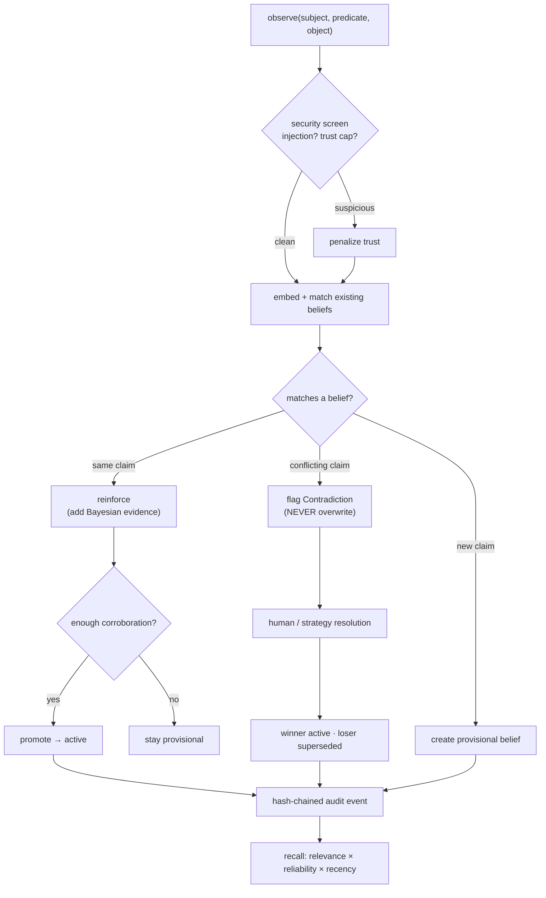
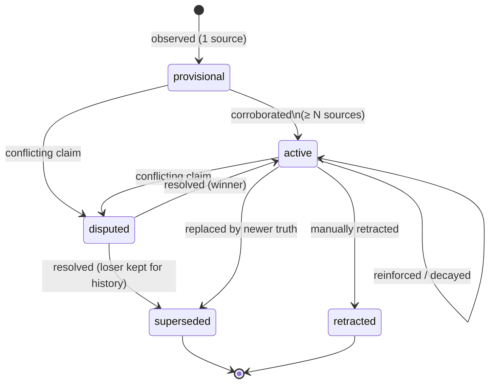

# Anchor

**Persistent belief-memory infrastructure for AI agents** — with provenance,
Bayesian confidence, reinforcement, temporal reasoning, contradiction detection,
decay, and human-in-the-loop confirmation. Anchor never silently overwrites
conflicting memories.


> Anchor is *not* a chatbot or a thin RAG wrapper. It is a memory **engine**: a
> principled model of how an agent's beliefs form, strengthen, conflict, age,
> and get resolved over time — exposed over the Model Context Protocol so any
> agent framework can use it.


---

## Why Anchor

Most "agent memory" today is one of two things:

1. **Summary / key-value memory** that *overwrites* on update — it forgets
   history and is trivially poisoned.
2. **Vector RAG memory** that stores every utterance and retrieves by text
   similarity — it has *no notion of truth, recency, or contradiction* and
   happily returns stale or conflicting facts.

Anchor treats memory as a set of **beliefs** — structured, provenanced,
probabilistic claims that evolve:

| Capability | Summary | RAG | **Anchor** |
|---|:--:|:--:|:--:|
| Remembers history | ❌ | ✅ | ✅ |
| Tracks *current truth* | ⚠️ | ❌ | ✅ |
| Confidence & reinforcement | ❌ | ❌ | ✅ |
| Temporal validity & decay | ❌ | ❌ | ✅ |
| Contradiction detection | ❌ | ❌ | ✅ |
| Human confirmation workflow | ❌ | ❌ | ✅ |
| Provenance & tamper-evident audit | ❌ | ❌ | ✅ |
| Memory-poisoning defenses | ❌ | ❌ | ✅ |

### Measured results (synthetic benchmark, `python -m anchor.eval.benchmark`)

30 memory slots, 200+ events, value updates + low-trust poisoning attacks:

| memory | accuracy | update_acc | poison_resist |
|---|:--:|:--:|:--:|
| summary (overwrite) | 0.70 | 0.78 | 0.00 |
| rag (vector) | 0.63 | 0.56 | 0.56 |
| **anchor** | **1.00** | **1.00** | **1.00** |

(Deterministic, fully offline. Numbers reproduce via the command above.)

---

## How it works

Every observation flows through the same principled pipeline — screened,
weighed, corroborated or contradicted, and recorded in a tamper-evident log:



---

## Core concepts

- **Belief** — the atomic memory unit: a `(subject, predicate, object)` claim
  with a *polarity*, a Bayesian confidence (Beta `alpha`/`beta`), a temporal
  validity window, provenance, and lifecycle status
  (`provisional → active → disputed → superseded/retracted`).

Every belief moves through a well-defined lifecycle — it is **never silently
overwritten**:



- **Reinforcement** — repeated corroboration adds *evidence* (`alpha`),
  increasing confidence; promotion to `active` can require multiple sources.
- **Confidence** — the posterior mean of a Beta distribution; ranking uses a
  conservative *lower bound* so well-corroborated memories beat merely-plausible
  ones. See [anchor/core/confidence.py](anchor/core/confidence.py).
- **Temporal reasoning** — beliefs have `valid_from`/`valid_to`; un-reinforced
  evidence **decays** toward "unknown" (a half-life model), and faded beliefs
  auto-retire.
- **Contradiction detection** — a differing claim on a *functional* predicate,
  or an opposite-polarity claim, is surfaced as a `Contradiction` — **never a
  silent overwrite**. Multi-valued predicates coexist.
- **Resolution** — strategies: `keep_new`, `keep_existing`, `highest_confidence`,
  `newest`, `reliable` (confidence-lower-bound × recency; poisoning-robust),
  `keep_both`, or `manual`. Losers are *superseded*, not deleted.
- **Provenance & audit** — every change emits a **hash-chained, tamper-evident**
  audit event. See [anchor/core/store.py](anchor/core/store.py).
- **Security** — input hygiene + prompt-injection screening, provenance-weighted
  and **per-source-capped** evidence (anti-flooding/Sybil), and corroboration
  requirements. See [anchor/core/security.py](anchor/core/security.py).

---

## Install

```bash
pip install -e .              # core engine (pure stdlib, zero deps)
pip install -e ".[cli]"       # + rich CLI tables
pip install -e ".[mcp]"       # + MCP server
pip install -e ".[llm]"       # + OpenAI/Anthropic embeddings
pip install -e ".[dev]"       # + pytest/ruff
```

The **core engine has no third-party dependencies** and runs fully offline using
a deterministic local embedding, so tests and demos are reproducible anywhere.

## Quickstart (Python)

```python
from anchor import Anchor

mem = Anchor()

mem.observe("user", "lives_in", "Berlin", source_id="chat", trust=0.9)
mem.observe("user", "lives_in", "Berlin", source_id="calendar", trust=0.9)  # reinforced -> active

r = mem.observe("user", "lives_in", "Munich", source_id="chat", trust=0.95)
print(r.action)                       # "contradicted"  (NOT overwritten)

con = mem.open_contradictions()[0]
mem.resolve_contradiction(con.id, strategy="newest", actor="human")

print(mem.current_belief("user", "lives_in").object)   # "Munich"
print(mem.verify_audit())             # True  (tamper-evident)
```

## CLI

```bash
anchor demo                                   # scripted, animated showcase
anchor shell                                  # interactive REPL: type facts & questions
anchor observe user lives_in Berlin --trust 0.9
anchor recall "where does the user live?"
anchor contradictions
anchor resolve <id> --strategy reliable
anchor decay
anchor audit
anchor stats
```

### Interactive shell

Type facts and questions live in one session — memory persists to the database:

```text
$ anchor shell
anchor> observe user lives_in Berlin --trust 0.9 --source-id chat
anchor> observe user lives_in Berlin --trust 0.9 --source-id calendar
anchor> recall where does the user live?
anchor> observe user lives_in Munich --trust 0.95
anchor> contradictions
anchor> quit
```

Inside the shell, `recall` accepts a free-form question without quotes. Type
`help` for the full command list.

See the full narrated walkthrough:

```bash
python -m anchor.cli.app demo
```

<!-- To showcase a live recording, drop a GIF at docs/assets/demo.gif and it will
     render here:   -->

## MCP server

Expose Anchor to LangGraph / CrewAI / AutoGen / custom agents:

```bash
anchor-mcp            # stdio transport
```

Example client config (Claude Desktop / any MCP host):

```json
{
  "mcpServers": {
    "anchor": {
      "command": "anchor-mcp",
      "env": { "ANCHOR_DB": "/path/to/anchor.db" }
    }
  }
}
```

Tools exposed: `anchor_observe`, `anchor_recall`, `anchor_list_beliefs`,
`anchor_open_contradictions`, `anchor_resolve_contradiction`, `anchor_retract`,
`anchor_apply_decay`, `anchor_audit`, `anchor_stats`. See
[anchor/mcp/server.py](anchor/mcp/server.py).

## Configuration

All dynamics are tunable via `AnchorConfig` or `ANCHOR_*` env vars — priors,
reinforcement/contradiction gains, promotion/retirement thresholds, decay and
recency half-lives, similarity thresholds, evidence caps, and the embedding
provider (`local` | `openai`). See [anchor/config.py](anchor/config.py).

## Architecture

```
anchor/
  core/
    models.py         # Belief, Provenance, Contradiction, AuditEvent
    confidence.py     # Bayesian reinforcement / decay / lower bound
    contradiction.py  # relationship taxonomy + predicate cardinality
    embeddings.py     # local (offline) + OpenAI providers
    security.py       # injection screening + evidence caps
    store.py          # SQLite + hash-chained audit (Postgres-ready SQL)
    engine.py         # the Anchor orchestrator (framework-independent)
  mcp/server.py       # Model Context Protocol server
  cli/                # rich CLI + scripted demo
  eval/               # benchmark vs summary/RAG baselines
  observability.py    # JSON logging + metrics
```

More detail in [docs/ARCHITECTURE.md](docs/ARCHITECTURE.md).

## Tests

```bash
python -m pytest -q
```

47 tests cover confidence math, storage & audit tamper-detection, contradiction
logic, security defenses, temporal decay, the engine lifecycle, and the
evaluation harness.

## Design principles

1. **Never silently overwrite** conflicting memory — surface and resolve.
2. **Confidence is earned** — Bayesian evidence, corroboration, and trust.
3. **Memory is time-aware** — validity windows, decay, recency.
4. **Everything is auditable** — hash-chained provenance.
5. **The core is framework-independent** — SQLite + stdlib; integrations are thin.

## License

Apache-2.0. See [LICENSE](LICENSE).
