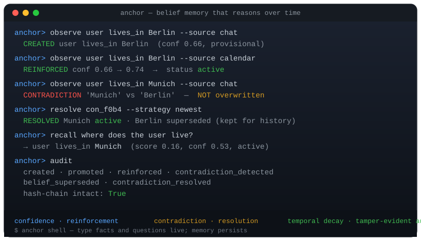
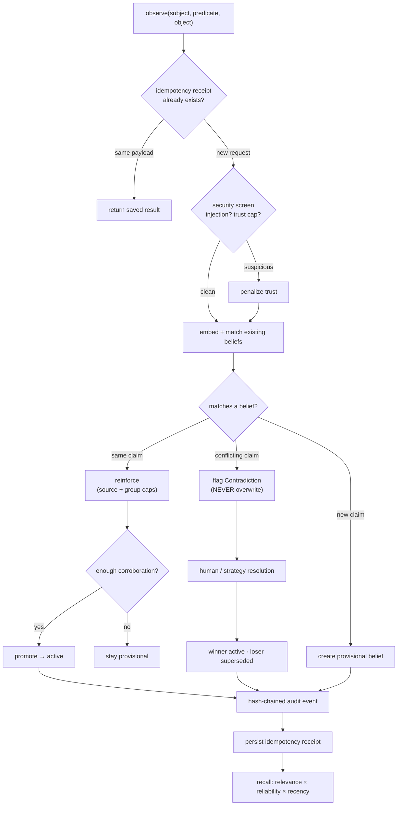
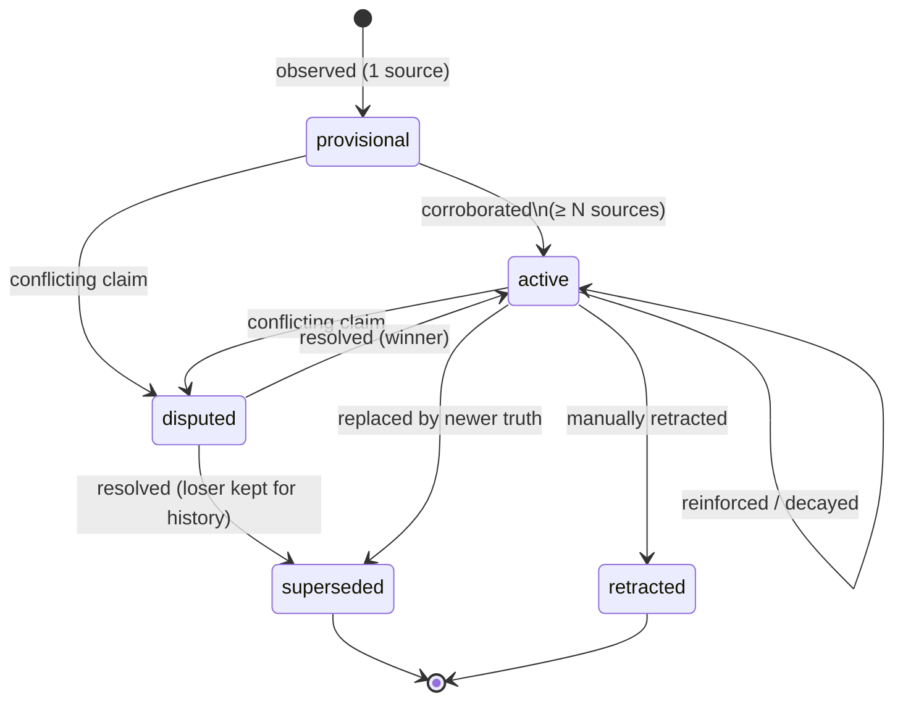

<div align="center">

#  Anchor

### Persistent belief-memory infrastructure for AI agents



**Agents don't have a memory problem. They have a *truth* problem.**

Anchor gives an agent beliefs that form, strengthen, conflict, age and get
resolved — with provenance, Bayesian confidence, contradiction detection and a
tamper-evident audit trail. **It never silently overwrites what it knows.**


</div>

---

## What makes this strong

Not a wrapper around an LLM. A memory **engine** with the properties you'd
demand of a system of record:

| | |
|---|---|
| **Never loses truth** | A conflicting claim raises a contradiction; the old belief is *superseded*, never deleted. Every prior state is recoverable. |
| **Resists poisoning** | Trust weighting, per-source evidence caps and conservative lower-bound ranking. **1.00 poison resistance** against a repeated low-trust source, where overwrite memory scores 0.00 — [with the limits measured, not hidden](#where-this-breaks). |
| **Explains itself** | Every belief answers *why* — credible interval, per-source attribution, decay forecast, audit timeline. Reconstructed from the ledger, so it cannot drift. |
| **Tamper-evident** | SHA-256 hash-chained audit log per namespace. `verify_audit()` detects any retroactive edit. |
| **Tenant-safe** | Namespace-scoped bearer tokens enforce data isolation at the API boundary; a tenant token cannot read or mutate another tenant. |
| **Retry-safe** | Durable idempotency receipts make observation retries safe and reject key reuse with a different payload. |
| **Operationally recoverable** | Online, integrity-checked SQLite backups plus `anchor doctor` for database and audit-chain diagnostics. |
| **Time-aware** | Beliefs have validity windows; unconfirmed evidence decays on a half-life and faded beliefs auto-retire. |
| **Zero core dependencies** | Engine, HTTP server, dashboard, knowledge graph and SVG renderer are **pure stdlib**. Fully offline, deterministic, reproducible. |
| **Production surfaces** | REST + SSE + Prometheus, MCP server, CLI, live dashboard, and OpenAI/Anthropic/LangChain adapters. |
| **Honest by construction** | 122 tests. Every README visual is generated from a live engine run — the hero banner *refuses to render* if the engine stops behaving as advertised, and the benchmark ships the sweep that finds its own weaknesses. |

### Where Anchor creates real value

Anchor is designed for systems where an incorrect remembered fact has a real
cost: customer-support agents retaining account preferences, operations copilots
tracking changing constraints, regulated assistants that must explain their
sources, and multi-agent workflows where tools may disagree. It turns those
facts into governed state with tenant boundaries, retry safety, provenance,
contradiction review, recovery procedures and measurable failure modes.

---

## The problem

Every agent that remembers things eventually hits some version of this:

> *The user said they moved to Munich. The agent kept booking flights to Berlin.*
> *Or worse — a scraped page said "Munich", and the agent believed it over the user.*

Agent memory today is one of two broken things:

| | What it does | How it fails |
|---|---|---|
| **Summary / key-value memory** | Overwrites the slot on update | Forgets history and is **trivially poisoned** — the last writer wins, even if it's an untrusted scraper |
| **Vector RAG memory** | Stores every utterance, retrieves by similarity | **No notion of truth, recency or conflict** — returns "Berlin" and "Munich" side by side and lets the LLM guess |

Both share one root cause: **they store *text*, not *beliefs*.** There is no
representation of *how strongly* something is believed, *who said it*, *when it
stopped being true*, or *what contradicts it*.

## The solution

Anchor models memory the way a careful analyst does — as **beliefs**: structured,
provenanced, probabilistic claims that evolve over time.

When a new claim conflicts with an existing one, Anchor **does not overwrite it**.
It raises a contradiction, keeps both, and asks:




---

## How it compares

<div align="center">



</div>

---

## Measured, not asserted

Anchor ships its own adversarial benchmark: 30 memory slots, 201 events, 18
mid-stream value changes, 9 poisoning attempts. Five memory strategies,
same data, deterministic and fully offline.

```bash
python -m anchor.eval.benchmark        # or: anchor bench --json results.json
```

| memory | accuracy | update acc. | poison resist. | stale resist. |
|---|:--:|:--:|:--:|:--:|
| summary (overwrite) | 0.70 | 0.78 | **0.00** | 1.00 |
| recency window | 0.70 | 0.78 | **0.00** | 1.00 |
| trust vote | 0.33 | 0.17 | **0.11** | 0.33 |
| rag (vector) | 0.67 | 0.61 | 0.56 | 0.67 |
| **anchor** | **1.00** | **1.00** | **1.00** | **1.00** |

*Attacker model: one identity at trust 0.25, against legitimate sources at 0.9.
That caveat matters — [see where this breaks](#where-this-breaks).*



**The interesting result isn't that Anchor wins — it's *how each baseline loses*.**
They fail on *different* axes, and the fixes are mutually exclusive:

- **Overwrite memory** is perfectly current and **completely defenceless** (0.00) —
  the poisoner simply writes last.
- **Trust voting** resists poisoning slightly, but majority-votes itself into stale
  answers; it can barely accept a legitimate change (0.17 update accuracy).
- **Vector RAG** is mediocre everywhere, because similarity search has no opinion
  about truth.

You cannot patch your way from any of these to correctness — freshness and
poison-resistance pull in opposite directions. You need **evidence, provenance and
corroboration as first-class state**. That is the entire thesis.

> **On reading these numbers honestly:** this is a *synthetic* benchmark written
> by the same author as the engine, with baselines implemented for comparison
> rather than tuned to win. It is designed to demonstrate the structural tension
> between freshness and poison-resistance — not to prove production performance on
> real workloads. Every number reproduces offline via the command above, and the
> harness is in [anchor/eval/](anchor/eval/) so you can disagree with it in code.



---

## Where this breaks

A perfect score on your own benchmark is a claim about the benchmark, not the
system. So Anchor ships the sweep that attacks its own headline number:

```bash
python -m anchor.eval.benchmark --sweep    # or: anchor bench --sweep
```

**It is not a cherry-picked scenario.** Holding config fixed and varying only the
seed — 1.00 across seeds 7, 13, 42, 99, 1234, 2026. Three of those are pinned in
the test suite.

**But one hyperparameter does all the work.** Ablating the benchmark config one
knob at a time:

| config | accuracy | poison resist. |
|---|:--:|:--:|
| all tuned | 1.00 | **1.00** |
| default `min_sources_for_active` | 1.00 | 1.00 |
| default `recency_half_life` | 1.00 | 1.00 |
| default `max_source_evidence` | 0.87 | **0.56** |

The per-source evidence cap *is* the result. The other two knobs are decorative
on this scenario — and the benchmark's attack is "one source repeats itself 6–12
times", which is exactly what an evidence cap is built to stop. The benchmark
grades Anchor on its own threat model.

**Two changes take it to zero.** Raising the attacker's trust toward the
legitimate sources' 0.9:

| attacker trust | 0.25 | 0.50 | 0.60 | 0.90 |
|---|:--:|:--:|:--:|:--:|
| poison resistance | **1.00** | 0.56 | **0.00** | **0.00** |

And splitting the attacker across identities — the evidence cap is *per source*,
so N identities buy N× the cap:

| attacker identities | 1 | 2 | 3 | 5 | 10 | 20 |
|---|:--:|:--:|:--:|:--:|:--:|:--:|
| poison resistance | **1.00** | 0.56 | 0.56 | **0.33** | 0.33 | 0.33 |

When those identities are known to belong to the same trust domain, callers can
assign a shared `source_group`. The identities then consume one aggregate evidence
budget instead of multiplying their influence:

| attacker identities in one group | 1 | 2 | 3 | 5 | 10 | 20 |
|---|:--:|:--:|:--:|:--:|:--:|:--:|
| poison resistance | **1.00** | **1.00** | **1.00** | **1.00** | **1.00** | **1.00** |

This is a mitigation for *known correlation*, not automatic identity detection.
The full paired experiment is generated by `anchor bench --sweep`.

### What the headline number actually means

> Anchor resists poisoning when the attacker is a **single source**, **already
> labelled low-trust**, that **repeats itself**.

That is a real and useful property — it covers the scraped-page and
compromised-tool cases that break overwrite memory today. It is *not* "poison
resistance 1.00" in general

**Known gaps, stated plainly:**

- **No automatic Sybil detection.** Shared source-group caps stop known correlated
  identities from multiplying their influence, but Anchor does not discover those
  relationships. Without operator-supplied correlation metadata, identities are
  independent and the ungrouped Sybil result above still applies.
- **Trust is an input, not an inference.** Anchor believes the trust score you
  hand it. It does not learn that a source has started lying. Source reliability
  should be estimated from its contradiction history.
- **Equal trust means newest wins.** At trust parity a newer claim displaces an
  older one. That is arguably correct, but it means trust asymmetry is doing the
  security work, and trust asymmetry is your job to configure.

Those three are pinned by tests in [tests/test_eval.py](tests/test_eval.py), so
if a future change fixes one, the suite fails and this section gets updated.

> **On reading any of these numbers:** this is a *synthetic* benchmark written by
> the same author as the engine, with baselines implemented for comparison rather
> than tuned to win. It demonstrates a structural tension between freshness and
> poison-resistance — it does not prove production performance on real workloads.
> Every number reproduces offline, and the harness is in
> [anchor/eval/](anchor/eval/) so you can disagree with it in code.

---

## Live control plane

Anchor ships a **dependency-free HTTP API and real-time dashboard** — built on
`http.server`, Server-Sent Events and a hand-written SVG renderer. No React, no
build step, no `node_modules`.

```bash
anchor serve --open          # http://127.0.0.1:8080
```

A live operator console: belief table with confidence bars, animated knowledge
graph, a **contradiction inbox** with one-click resolution strategies, a streaming
audit feed, and a slide-out explainability drawer for any belief.

```text
GET  /                     dashboard (single self-contained HTML document)
GET  /api/stats            memory health
GET  /api/beliefs          current beliefs
GET  /api/contradictions   the inbox
GET  /api/recall?q=...     ranked retrieval
GET  /api/explain/<id>     full explanation payload
GET  /api/graph            knowledge graph (nodes + edges + layout)
GET  /api/audit            hash-chained history
GET  /api/events           Server-Sent Events — live stream
GET  /metrics              Prometheus exposition format
POST /api/observe · /api/resolve · /api/retract · /api/decay · /api/seed
```

**Security posture:** loopback-only by default, optional bearer token (compared in
constant time), CORS off unless explicitly enabled, request body capped, strict
`nosniff` / `DENY` / `no-referrer` headers, no filesystem serving — and the
dashboard renders every value via `textContent`, so `innerHTML` and `eval` appear
nowhere in it. There is a test that enforces exactly that.

```bash
ANCHOR_API_TOKEN=secret anchor serve --host 0.0.0.0 --token secret
```

For shared deployments, give each tenant a namespace-scoped token. The server
derives the tenant namespace from the token. Cross-namespace collection requests
return `403`; direct belief and explanation URLs outside the tenant return `404`
so object existence is not disclosed:

```bash
export ANCHOR_TENANT_TOKENS='{"acme":"replace-acme-token","globex":"replace-globex-token"}'
anchor serve --host 0.0.0.0

curl -H 'Authorization: Bearer replace-acme-token' \
  'http://127.0.0.1:8080/api/beliefs'
```

For the operator console, open `/?namespace=acme`, paste the tenant token into
the password field and choose **Connect**. The token is retained only in that
browser tab's session storage and authenticated live events use the bearer header.

Observation writes support the standard `Idempotency-Key` header. Repeating an
identical request returns the saved result without adding evidence twice; reusing
the key for a different payload returns `409 Conflict`.

```bash
curl -X POST http://127.0.0.1:8080/api/observe \
  -H 'Authorization: Bearer replace-acme-token' \
  -H 'Idempotency-Key: crm-event-8b19' \
  -H 'Content-Type: application/json' \
  -d '{"subject":"customer-42","predicate":"prefers","object":"email",\
       "source_id":"crm-primary","source_group":"crm","trust":0.95}'
```

The SSE stream is produced by tailing the **audit log**, not by hooking the engine
— so it reflects committed state and works across processes.

## Enterprise deployment and operations

The supplied container runs as an unprivileged user, writes only to `/data`, has
a health check, and works with a read-only root filesystem. Compose binds to
loopback by default and enables `no-new-privileges`.

```bash
cp .env.example .env
# Replace every example token in .env before starting.
docker compose up --build -d
curl http://127.0.0.1:8080/health
```

Operational checks and backups are explicit commands, suitable for a scheduler
or runbook:

```bash
anchor --db /data/anchor.db doctor
anchor --db /data/anchor.db backup /backups/anchor-$(date +%F).db
```

`backup` uses SQLite's online backup API, then opens the copy and runs an
integrity check before reporting success. `doctor` verifies both SQLite integrity
and the namespace audit chain. Production operators should copy verified backups
to independent encrypted storage and test restoration on a schedule.

CI tests Python 3.10–3.13, builds and installs the wheel in a clean environment,
builds the container, runs static security analysis and audits installed Python
packages. Dependabot checks Python, GitHub Actions and Docker dependencies weekly.

---

## Explainability — *why* does the agent believe this?

The most valuable thing a memory system can do is **defend its own answer**.

```bash
anchor explain <belief-id>
```

Real output from a run where three trusted sources say *Berlin* and one low-trust
bot says *Munich*:

```text
──────────────────────── user lives_in Berlin ────────────────────────
confidence 0.747   lower bound 0.519   95% CI 0.398–1.000
evidence alpha=3.70 beta=1.25   status disputed   age 0.0d   stale 0.0d

evidence by source
  source       supporting  contradicting  share  obs  capped
  calendar           0.90           0.00    33%    1
  chat               0.90           0.00    33%    1
  hr_system          0.90           0.00    33%    1
  rumour_bot         0.00           0.25     0%    1

why memory holds this
  • Corroborated by 3 independent sources (calendar, chat, hr_system).
  • Reinforced 3 times without being refuted.
  • Challenged by 1 source(s) (rumour_bot); 1 contradiction(s) recorded.
  • Disputed: a conflicting claim is open and awaiting resolution.
  • Ranking uses the conservative lower bound 0.519 rather than the mean
    0.747, so thinly-supported claims cannot outrank well-corroborated ones.

if never reinforced again        audit timeline
  in days   confidence             created
        0        0.747             promoted
        7        0.731             reinforced
       30        0.676             reinforced
       90        0.565
      180        0.509
```

Note what the low-trust bot actually achieved: it nudged confidence from 0.787 to
0.747, flipped the status to `disputed`, and opened a contradiction for review. It
did **not** change the answer. That is the whole point.

Explanations are a **read-only projection** — reconstructed from the evidence
ledger and audit chain on every call, so they can never drift from what the engine
actually did. Available in Python (`mem.explain(id)`), over REST, over MCP, and in
the dashboard drawer.

---

## Knowledge graph

Beliefs aren't isolated rows — they form a graph. Anchor projects them into a
confidence-weighted graph with **contradiction edges rendered as live pulsing
links**, laid out by a deterministic seeded force-directed algorithm.



```bash
anchor graph --format mermaid        # paste straight into docs
anchor graph --format dot -o g.dot   # Graphviz
anchor graph --format svg -o g.svg   # animated, self-contained
anchor graph --format json           # feed your own UI
```

---

## Confidence is earned, and lost

A belief's confidence is the posterior mean of a Beta distribution. Corroboration
raises it, contradiction lowers it, and **silence decays it** — a fact nobody has
confirmed in six months deserves less trust than one confirmed today.



Ranking never uses the mean. It uses a **conservative lower bound** (~10th
percentile), so a claim corroborated by four sources beats a claim asserted once,
loudly. That, together with trust weighting, per-source evidence caps and the
refusal to overwrite on conflict, is what produces the poison resistance above.

---

## How it works

Every observation flows through the same pipeline — screened, weighed,
corroborated or contradicted, and recorded in a tamper-evident log:



Every belief moves through a well-defined lifecycle. It is **never silently
overwritten** — losers are *superseded*, not deleted:



---

## Install

```bash
pip install -e .              # core engine (pure stdlib, zero deps)
pip install -e ".[cli]"       # + rich CLI tables
pip install -e ".[mcp]"       # + MCP server
pip install -e ".[langchain]" # + LangChain tool adapters
pip install -e ".[llm]"       # + OpenAI/Anthropic embeddings
pip install -e ".[dev]"       # + pytest/ruff
```

The **core engine, HTTP server, dashboard, knowledge graph and SVG renderer have
zero third-party dependencies** and run fully offline on a deterministic local
embedding — so tests, demos and benchmarks reproduce anywhere, byte for byte.

## Quickstart

```python
from anchor import Anchor

mem = Anchor()

mem.observe("user", "lives_in", "Berlin", source_id="chat", trust=0.9)
mem.observe("user", "lives_in", "Berlin", source_id="calendar",
            source_group="first_party", trust=0.9,
            idempotency_key="calendar-event-381")  # → active

r = mem.observe("user", "lives_in", "Munich", source_id="chat", trust=0.95)
print(r.action)                       # "contradicted"  — NOT overwritten

con = mem.open_contradictions()[0]
mem.resolve_contradiction(con.id, strategy="newest", actor="human")

belief = mem.current_belief("user", "lives_in")
print(belief.object)                  # "Munich"
print(mem.explain(belief.id).summary) # why it is believed, and how strongly
print(mem.verify_audit())             # True — tamper-evident
```

## Drop it into your agent

`AnchorToolkit` emits ready-made tool schemas for OpenAI, Anthropic and LangChain,
and dispatches the calls for you:

```python
from anchor import Anchor
from anchor.adapters import AnchorToolkit

kit = AnchorToolkit(Anchor(), namespace="user-42")

resp = openai.chat.completions.create(
    model="gpt-4o",
    messages=[{"role": "system", "content": kit.SYSTEM_PROMPT}, *messages],
    tools=kit.openai_tools(),      # or kit.anthropic_tools() / kit.langchain_tools()
)

for call in resp.choices[0].message.tool_calls:
    result = kit.dispatch(call.function.name, call.function.arguments)
```

The toolkit returns **guidance alongside every result**, so the model knows what to
do with a conflict instead of hallucinating past it:

```json
{
  "action": "contradicted",
  "guidance": "Conflicts with an existing belief. Nothing was overwritten;
               ask the user which is true, then call anchor_resolve_contradiction."
}
```

Pass `allow_writes=False` for a read-only toolkit when you don't want the model
mutating memory.

---

## Core concepts

- **Belief** — the atomic memory unit: a `(subject, predicate, object)` claim
  with a *polarity*, a Bayesian confidence (Beta `alpha`/`beta`), a temporal
  validity window, provenance, and lifecycle status
  (`provisional → active → disputed → superseded/retracted`).
- **Reinforcement** — repeated corroboration adds *evidence* (`alpha`),
  increasing confidence; promotion to `active` can require multiple sources.
- **Source groups** — identities known to share an owner, pipeline or trust
  domain consume one aggregate evidence cap. This limits correlated-source
  amplification without pretending to discover hidden relationships.
- **Idempotency** — an optional key records the request hash and result durably
  per namespace, making normal client retries safe and detecting conflicting key
  reuse.
- **Confidence** — the posterior mean of a Beta distribution; ranking uses a
  conservative *lower bound* so well-corroborated memories beat merely-plausible
  ones. See [anchor/core/confidence.py](anchor/core/confidence.py).
- **Temporal reasoning** — beliefs have `valid_from`/`valid_to`; un-reinforced
  evidence **decays** toward "unknown" (a half-life model), and faded beliefs
  auto-retire.
- **Contradiction detection** — a differing claim on a *functional* predicate,
  or an opposite-polarity claim, is surfaced as a `Contradiction` — **never a
  silent overwrite**. Multi-valued predicates coexist.
- **Resolution** — strategies: `keep_new`, `keep_existing`, `highest_confidence`,
  `newest`, `reliable` (confidence-lower-bound × recency; poisoning-robust),
  `keep_both`, or `manual`. Losers are *superseded*, not deleted.
- **Explanation** — a reconstructed projection: credible interval, per-source
  attribution, decay projection and audit timeline.
  See [anchor/core/explain.py](anchor/core/explain.py).
- **Provenance & audit** — every change emits a **hash-chained, tamper-evident**
  audit event. See [anchor/core/store.py](anchor/core/store.py).
- **Security** — input hygiene + prompt-injection screening, provenance-weighted
  evidence capped per source and per declared source group, tenant-scoped API
  tokens, and corroboration requirements. See
  [anchor/core/security.py](anchor/core/security.py).

---

## CLI

```bash
anchor demo                                   # scripted, animated showcase
anchor shell                                  # interactive REPL: type facts & questions
anchor serve --open                           # live dashboard + REST API
anchor observe user lives_in Berlin --trust 0.9 --source-group first-party \
  --idempotency-key event-381
anchor recall "where does the user live?"
anchor explain <belief-id>                    # why is this believed?
anchor graph --format mermaid                 # knowledge graph
anchor contradictions
anchor resolve <id> --strategy reliable
anchor bench --json results.json              # run the benchmark
anchor render-assets                          # regenerate every animated SVG
anchor backup backups/anchor.db               # verified online backup
anchor doctor                                 # DB + audit-chain health check
anchor decay · anchor audit · anchor stats
```

### Interactive shell

Type facts and questions live in one session — memory persists to the database:

```text
$ anchor shell
anchor> observe user lives_in Berlin --trust 0.9 --source-id chat
anchor> observe user lives_in Berlin --trust 0.9 --source-id calendar
anchor> recall where does the user live?
anchor> observe user lives_in Munich --trust 0.95
anchor> contradictions
anchor> quit
```

Inside the shell, `recall` accepts a free-form question without quotes. Type
`help` for the full command list.

## MCP server

Expose Anchor to LangGraph / CrewAI / AutoGen / Claude Desktop / any MCP host:

```bash
anchor-mcp            # stdio transport
```

Example client config:

```json
{
  "mcpServers": {
    "anchor": {
      "command": "anchor-mcp",
      "env": { "ANCHOR_DB": "/path/to/anchor.db" }
    }
  }
}
```

Tools exposed: `anchor_observe`, `anchor_recall`, `anchor_current_belief`,
`anchor_explain`, `anchor_graph`, `anchor_list_beliefs`,
`anchor_open_contradictions`, `anchor_resolve_contradiction`, `anchor_retract`,
`anchor_apply_decay`, `anchor_audit`, `anchor_stats`. See
[anchor/mcp/server.py](anchor/mcp/server.py).

## Configuration

All dynamics are tunable via `AnchorConfig` or `ANCHOR_*` env vars — priors,
reinforcement/contradiction gains, promotion/retirement thresholds, decay and
recency half-lives, similarity thresholds, per-source and per-group evidence
caps, and the embedding provider (`local` | `openai`). Runtime controls include
`ANCHOR_API_TOKEN` and the namespace-to-token JSON map
`ANCHOR_TENANT_TOKENS`. See [anchor/config.py](anchor/config.py) and
[.env.example](.env.example).

## Architecture

```
anchor/
  core/
    models.py         # Belief, Provenance, Contradiction, AuditEvent
    confidence.py     # Bayesian reinforcement / decay / lower bound
    contradiction.py  # relationship taxonomy + predicate cardinality
    explain.py        # read-only explanation projection
    graph.py          # belief -> knowledge graph + force-directed layout
    embeddings.py     # local (offline) + OpenAI providers
    security.py       # injection screening + evidence caps
    store.py          # SQLite + audit chain + idempotency + online backup
    engine.py         # the Anchor orchestrator (framework-independent)
  server/
    api.py            # tenant-safe REST, SSE, idempotency, Prometheus
    dashboard.py      # self-contained live operator console
  viz/                # animated SVG generation (terminal casts, charts, graphs)
  adapters/           # OpenAI / Anthropic / LangChain tool schemas
  mcp/server.py       # Model Context Protocol server
  cli/                # rich CLI + scripted demo
  eval/               # benchmark vs four baselines
  observability.py    # JSON logging + metrics
.github/
  workflows/          # matrix tests, package/container build, security scans
  dependabot.yml      # weekly pip, Actions and Docker updates
Dockerfile            # non-root production image with health check
docker-compose.yml    # hardened local/single-node deployment
```

More detail in [docs/ARCHITECTURE.md](docs/ARCHITECTURE.md).

## Tests

```bash
python -m pytest --cov=anchor --cov-fail-under=75   # 122 passing, 1 optional skip
ruff check .
```

Covering confidence math, storage and **audit tamper-detection**, contradiction
logic, security defenses, temporal decay, the engine lifecycle, explanations,
graph projection, tenant isolation, idempotency conflicts, correlated-source
caps, verified backup/restore, the HTTP API (including auth, body limits and
XSS-safety of the dashboard), SVG well-formedness and escaping, tool adapters,
and the adversarial evaluation harness.

## Design principles

1. **Never silently overwrite** conflicting memory — surface and resolve.
2. **Confidence is earned** — Bayesian evidence, corroboration, and trust.
3. **Memory is time-aware** — validity windows, decay, recency.
4. **Everything is auditable** — hash-chained provenance.
5. **Every answer is explainable** — reconstructed, never narrated.
6. **The core is framework-independent** — SQLite + stdlib; integrations are thin.
7. **Operations are part of correctness** — retries, isolation, diagnostics and
   recovery are tested behavior, not deployment notes.

## License

Apache-2.0. See [LICENSE](LICENSE).

<div align="center">
<sub>Built as an exploration of what agent memory should look like when you treat
truth as a first-class concern.</sub>
</div>
